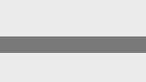

# Screens

Screenshots for the operator handbook.

The departures screen lists the next sailings from the selected port.

The delay banner shows above the list when a sailing is late.

The route overview is drawn from the timetable, one line per route.

The badge above shows whether the last timetable import passed.

The old booking flow is kept for partners on the 2023 contract.

Partners can embed a live departure board on their own site.
