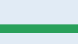
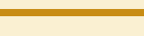
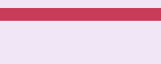
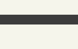

# Screens

Screenshots for the operator handbook.

The departures screen lists the next six sailings from the selected port.

The delay banner shows above the list when a sailing is late or cancelled.

The route overview is drawn from the timetable, one coloured line per route.

The badge above shows whether last night's timetable import passed.

The old booking flow is kept for partners on the 2023 contract.

Partners can embed a live departure board on their own site. A badge some partners pasted, , is not ours and never loads by itself.

The export dialog is new in this release.
