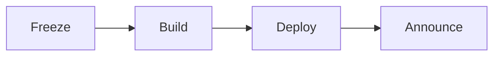

# Release checklist

Who may cut a release

Anyone on the platform team, with a second person watching.

The checklist runs top to bottom. Items marked <kbd>by hand</kbd> need a person at the keyboard.

<!-- TODO: link the smoke test page once it exists -->

## Load estimate

The expected peak load is

$$
L = \frac{p \cdot s}{t \cdot r}
$$

where p is passengers per sailing, s sailings per hour and t the booking window in hours and r the share booked online.

## Release flow

## Notes

Keep this page short.
